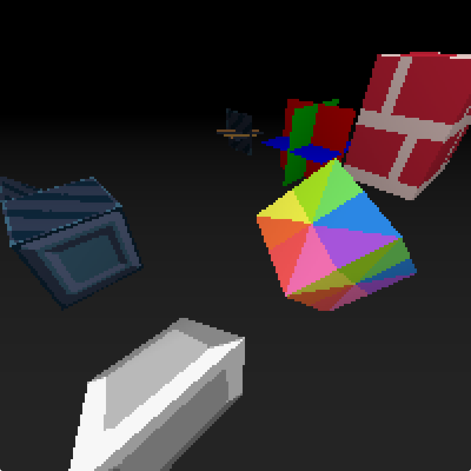
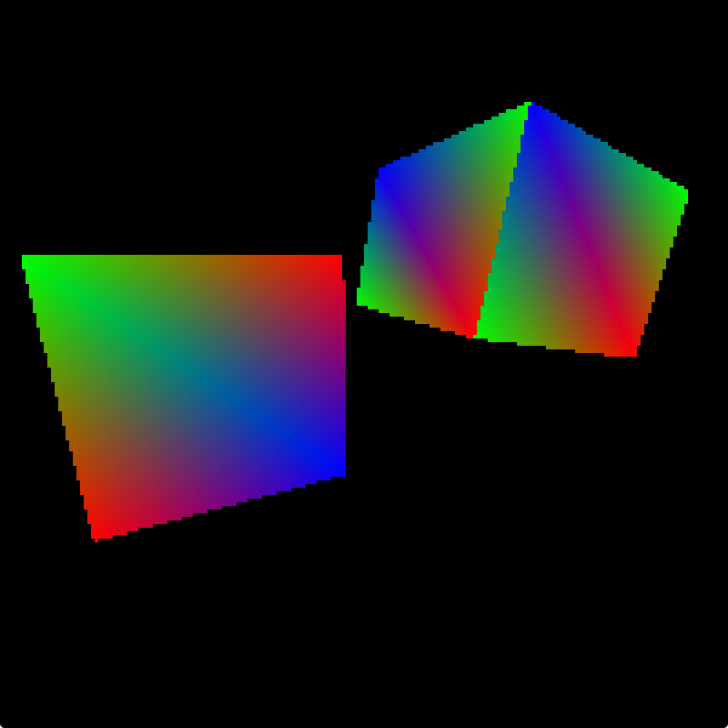

# 3D Software Rasterizer
3D CPU-based software rasterizer featuring textures, depth buffer, near plane clipping, fog and basic lighting, all done using Lua and Love 2D. No meshes or 3D methods are used, all pixels are programmatically placed by the program. The engine also supports scaling, moving and rotating of the said objects and supports any object as long as its vertice, UV and triangle data is supplied.



It's possible to define your own layouts and how each object behaves in [main.lua](main.lua). The engine will do most of the work for you. It's also possible to define your own shapes and geometry in [geometry.lua](geometry.lua) if necessary. Although, simple geometry such as faces, rectangles and wedges work out of the box.



## Controls
- mouse - look around
- w, a, s, d - move around
- q, e - move up or down

## Running
This project uses [LÖVE 2D](https://love2d.org/) and [Lua](https://lua.org/). Install both and then it's possible to run the project using this command:
```bash
love .
```

## Credits
This project was made by Daniel Vishnevsky and is licensed under MIT License.
