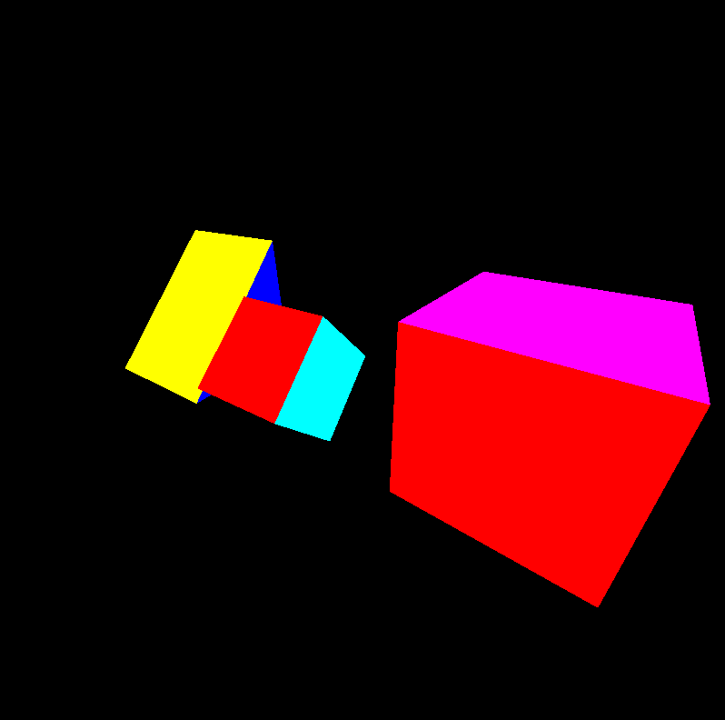

# 3D Engine
3D engine written in Lua and LÖVE 2D capable of rendering 3D objects. Right now it's capable of rendering rectangles and wedges but it's possible to add more objects to the engine. The engine also supports scaling, moving and rotating of the said objects. The engine is based off my previous one - [3D Toy Renderer](https://github.com/Acerx-AMJ/3D_toy_renderer).



It's possible to define your own layouts and how each object behaves in [main.lua](main.lua). The engine will do most of the work for you. Although, there are issues with triangle sorting and some triangles might appear when they shouldn't, especially if objects are close to each other.

## Controls
- mouse - look around
- w, a, s, d - move around
- q, e - move up or down

## Running
This project uses [LÖVE 2D](https://love2d.org/) and [Lua](https://lua.org/). Install both and then it's possible to run the project using this command:
```bash
love .
```

## Credits
This project was made by Daniel Vishnevsky and is licensed under MIT License.
